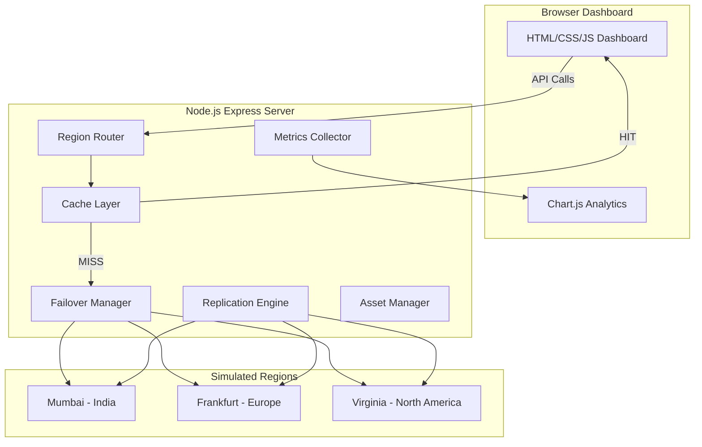

# Multi-Region Serverless Content Delivery Network

A full-featured simulation and demonstration of a Multi-Region Serverless Content Delivery Network (CDN) engineered with Node.js, Express, and an interactive Bootstrap 5 frontend dashboard. This platform provides an intuitive, hands-on environment for studying modern cloud content delivery architectures, regional routing, cache eviction policies, automatic failover resilience, cross-region data replication, and real-time performance analytics without requiring expensive cloud subscriptions or vendor lock-in.

---

## Abstract

Content Delivery Networks (CDNs) constitute the backbone of modern high-performance web applications, mitigating geographic latency and offloading origin servers by caching digital assets at edge locations distributed globally. However, learning and experimenting with carrier-grade cloud CDNs (such as Cloudflare, AWS CloudFront, or Fastly) typically entails steep financial costs, complex infrastructure provisioning, intricate DNS record configurations, and cloud account credentials that are often inaccessible to students and researchers.

This project implements a self-contained, multi-region serverless CDN simulator engineered from scratch using Node.js and Express. It simulates edge points of presence (PoPs) across three distinct geographic regions: **Mumbai (Asia-Pacific / India)**, **Frankfurt (Europe)**, and **North Virginia (North America)**. Each simulated region models unique origin and edge round-trip propagation latencies (20ms, 120ms, and 180ms respectively), isolated regional storage partitions, and independent health lifecycle states.

The system demonstrates critical cloud computing concepts including in-memory edge caching with configurable Time-To-Live (TTL) expiration, automatic latency-optimized failover routing when primary regional nodes experience an outage, cross-region file replication, multipart asset management, and synthetic benchmark stress-testing. A dynamic browser dashboard provides real-time traffic telemetry and visualizes latency improvements and cache hit ratios via Chart.js analytics.

---

## Problem Statement

In contemporary distributed systems, delivering static and dynamic content efficiently to globally dispersed end-users presents significant architectural hurdles:

1. **Geographic Latency and Origin Bottlenecks:** Users located thousands of miles away from a centralized origin server suffer from elevated round-trip times (RTT), slow page load speeds, and poor quality of experience. Centralized servers also suffer from single points of failure and bandwidth saturation.
2. **High Cloud Infrastructure Costs:** Deploying and benchmarking multi-region edge deployments on commercial platforms like AWS, Google Cloud, or Azure incur recurring egress bandwidth charges, multi-zone storage costs, and API invocation fees.
3. **Black-Box Edge Invisibility:** Commercial CDN platforms obscure their internal routing mechanics, failover decisions, cache eviction triggers, and failover fallbacks behind proprietary abstraction layers, impeding student comprehension of fundamental distributed systems concepts.
4. **Resilience and High Availability Demands:** In real-world enterprise environments, unexpected regional data center outages, fiber-optic cable cuts, or power grid failures require automated failover routing to healthy backup regions without interrupting client availability.

This project directly resolves these challenges by providing an open, fully transparent, zero-cost, and deterministic local simulation platform that faithfully reproduces the core operational mechanics of a multi-region CDN.

---

## Objectives

The primary objectives of this project are:

- **Implement Multi-Region Edge Routing:** Route inbound content requests to the designated geographic region (Mumbai, Frankfurt, or North Virginia) while simulating realistic geographic latency profiles.
- **Engineer an In-Memory Edge Cache:** Build a high-performance key-value caching layer supporting configurable Time-to-Live (TTL), instant cache invalidation, cache bypassing (`noCache=true`), and metrics collection (hit/miss counts and hit rates).
- **Deliver Automated Fault Tolerance & Failover:** Construct a dynamic health-check and failover management engine that transparently reroutes traffic to the next lowest-latency healthy region when primary regional nodes experience failure.
- **Provide Cross-Region Data Replication:** Build an asset replication service capable of propagating digital assets between individual regions or broadcasting assets to all global storage nodes.
- **Support Comprehensive Asset Management:** Provide multipart file upload, storage enumeration, and multi-region file deletion with security sanitization against directory traversal vulnerabilities.
- **Track Real-Time Telemetry & Benchmarking:** Capture fine-grained request metrics (average latency, cache hit ratios, failover events, regional distribution) and provide an automated comparative benchmarking engine.
- **Deliver an Interactive Browser Dashboard:** Provide a responsive single-page control panel featuring interactive region outage toggles, live logs, file explorers, and Chart.js telemetry charts.
- **Ensure Industrial Software Quality:** Validate all system behaviors through an automated integration test suite built with Jest and Supertest.

---

## Existing System vs Proposed System

| Dimension | Existing System (Traditional / Commercial CDN) | Proposed System (Multi-Region CDN Simulation) |
| :--- | :--- | :--- |
| **Financial Cost** | High recurring costs for bandwidth egress, requests, and multi-region storage. | **Zero Cost:** Runs locally or within free serverless tiers without cloud bills. |
| **Setup Complexity** | Requires custom domain names, DNS CNAME mapping, SSL certificates, and IAM roles. | **Instant Setup:** Single `npm install` and `npm start` command with zero configuration. |
| **Infrastructure Overhead** | Requires managing real cloud infrastructure across multiple cloud provider consoles. | **Lightweight:** Self-contained Node.js Express server running on any standard operating system. |
| **Observability & Visibility** | Internal routing algorithms, cache lookups, and failover steps are opaque black boxes. | **Complete Transparency:** Every step of cache check, origin lookup, and failover routing is visible in real-time logs. |
| **Failure Simulation** | Cannot easily trigger deliberate regional outages without disrupting live services. | **Interactive Outage Simulation:** One-click region shutdown and recovery toggles via dashboard or REST API. |
| **Replication Control** | Automated background sync with eventual consistency delays and hidden transfer fees. | **Deterministic Replication:** Instant explicit replication between regions with verifiable filesystem feedback. |
| **Educational Accessibility**| Steep learning curve with complex enterprise vendor documentation. | **Beginner-Friendly:** Modular, fully commented JavaScript code suitable for academic learning and lab presentations. |

---

## System Architecture

The simulated CDN architecture follows an edge-to-origin pipeline decoupled into presentation, routing, caching, failover, telemetry, and storage layers:



### Component Interaction Flow

1. **Client Request:** The browser dashboard or HTTP client sends a content request `GET /api/content/:filename?region=mumbai`.
2. **Cache Inspection:** The `Region Router` queries the `Cache Layer` with a compound key `${region}:${filename}`.
   - **Cache HIT:** If the asset resides in memory and has not exceeded its TTL, edge latency is simulated (~15% of regional origin latency), and the cached payload is immediately returned to the client with `cache: 'HIT'`.
   - **Cache MISS:** If absent or expired, the request proceeds to origin resolution.
3. **Origin Resolution & Failover:** The `Failover Manager` checks if the requested region is currently healthy:
   - If healthy and the file exists in that region's storage directory, the primary region serves the file.
   - If the region is unhealthy (simulated outage) or does not host the file, the failover manager inspects remaining healthy regions sorted by latency ascending (`mumbai` [20ms] &rarr; `frankfurt` [120ms] &rarr; `virginia` [180ms]). The file is served from the closest available backup region with `failover: true`.
4. **Cache Ingestion:** The freshly retrieved file content is stored in the cache layer with its expiration timestamp.
5. **Telemetry Recording:** Latency, cache status, failover flags, and origin details are logged by the `Metrics Collector`.
6. **Data Presentation:** The UI consumes the response and polls `/api/metrics` to update Chart.js performance curves and real-time activity tables.

---

## Module Descriptions

### 1. `cache.js` (In-Memory Edge Caching)
- **Purpose:** Provides a fast in-memory key-value cache simulating regional edge points of presence.
- **Key Methods:**
  - `get(key)`: Retrieves a cached entry; automatically purges expired entries based on TTL and updates hit/miss counters.
  - `set(key, data, meta, ttl)`: Stores data with an epoch creation timestamp and TTL (default 60,000ms).
  - `has(key)`: Non-intrusive existence check without altering hit/miss counters.
  - `delete(key)`: Evicts a specific cache item.
  - `clear()`: Purges all stored items and resets hits and misses to zero.
  - `stats()`: Returns current storage count, total hits, total misses, and calculated percentage hit rate.
  - `setDefaultTTL(ms)`: Configures the global default TTL.

### 2. `failover.js` (High Availability & Regional Health Manager)
- **Purpose:** Tracks health statuses for all regions, simulates catastrophic regional outages, and determines optimal failover fallback paths.
- **Key Methods:**
  - `getRegions()`: Returns current configuration and health statuses for all regions.
  - `isHealthy(region)`: Checks whether a specific region is flagged healthy.
  - `simulateOutage(region)`: Toggles a region's health to `false`.
  - `restoreRegion(region)`: Restores a region's health to `true`.
  - `getHealthyRegions()`: Returns an array of healthy region IDs.
  - `resolve(filename, preferredRegion, storageBasePath)`: Evaluates whether the preferred region can serve the request; if not, scans healthy candidates in order of lowest simulated latency to retrieve the asset.

### 3. `replication.js` (Cross-Region Synchronization Engine)
- **Purpose:** Handles point-to-point and broadcast file replication across regional storage directories.
- **Key Methods:**
  - `replicateFile(filename, from, to, storageBasePath)`: Copies a file from source region storage to target region storage.
  - `replicateToAll(filename, from, storageBasePath)`: Broadcasts a file from a source region to all other available regions.

### 4. `metrics.js` (Telemetry & Performance Collector)
- **Purpose:** Records telemetry for all requests, aggregating latency statistics, cache hit rates, regional distribution, and event logs.
- **Key Methods:**
  - `record({ filename, region, cache, latency, failover, failoverFrom, status })`: Logs request execution, increments regional counters, and pushes structured entries to an in-memory rolling event buffer (max 200 items).
  - `getMetrics()`: Calculates average latency across past requests, total hit rates, failover event counts, and returns the 50 most recent logs.
  - `reset()`: Resets all metrics and logs to initial clean states.

### 5. `assets.js` (Asset Ingestion & Lifecycle Router)
- **Purpose:** Express router module managing multipart file uploads, catalog enumeration, and asset deletion across storage directories.
- **Key Endpoints:**
  - `GET /`: Lists all assets across all regions, deduplicating files and identifying which regions hold each asset.
  - `POST /upload`: Uses Multer memory storage to upload and save files to a selected region, with file extension whitelisting and 5MB size limit.
  - `DELETE /:filename`: Safely unlinks an asset from all storage regions where it exists.

### 6. `router.js` (Core CDN Dispatcher & Benchmark Suite)
- **Purpose:** Main routing pipeline tying together cache lookups, origin routing, failover, metrics recording, and synthetic load benchmarking.
- **Key Endpoints:**
  - `GET /content/:filename`: Executes the core CDN content delivery flow.
  - `GET /regions`: Returns regional health and latency profiles.
  - `POST /regions/:region/outage`: Simulates an outage for the selected region.
  - `POST /regions/:region/restore`: Recovers an outage region.
  - `GET /cache/stats` & `POST /cache/clear`: Cache diagnostics and manual cache purging.
  - `POST /replicate`: Triggers asset replication.
  - `GET /metrics`: Returns aggregated metrics data for dashboard visualization.
  - `POST /benchmark`: Runs automated iterations comparing cached vs uncached origin fetch and failover latency.

### 7. `index.js` (Server Application Bootstrap)
- **Purpose:** Top-level Express application orchestrator.
- **Responsibilities:** Initializes directory structures, seeds initial sample assets (`sample.txt` across Mumbai, Frankfurt, and Virginia), configures CORS and JSON parsers, serves static assets from `public/`, mounts API routers, and exports application components for integration testing.

---

## Technology Stack

| Technology | Purpose | Version |
| :--- | :--- | :--- |
| **Node.js** | Server-side JavaScript runtime environment | `>= 18.x` |
| **Express.js** | Minimalist web application framework and REST API engine | `^4.18.2` |
| **Multer** | Multipart/form-data middleware for handling file uploads | `^1.4.5-lts.1` |
| **CORS** | Cross-Origin Resource Sharing middleware | `^2.8.5` |
| **UUID** | Unique identifier generation for logging and benchmarking | `^9.0.0` |
| **Bootstrap 5** | Responsive UI styling, card containers, tables, and modal dialogues | `5.3.x (CDN)` |
| **Chart.js** | Dynamic canvas-based charting for latency distributions and hit rates | `4.4.x (CDN)` |
| **Font Awesome** | Vector iconography for regions, status badges, and actions | `6.4.x (CDN)` |
| **Jest** | Automated JavaScript unit and integration test framework | `^29.7.0` |
| **Supertest** | HTTP assertions library for programmatic Express API testing | `^6.3.3` |

---

## Installation Steps

Ensure [Node.js](https://nodejs.org/) (version 18 or higher) and `npm` are installed on your workstation.

```bash
# 1. Clone the project repository
git clone <repo-url>

# 2. Navigate to the project root directory
cd multiregion-cdn

# 3. Install required production and development dependencies
npm install

# 4. Start the CDN server
npm start
```

Once started, the server will display:
```
CDN Server running on http://localhost:3000
```
Open your browser and navigate to **`http://localhost:3000`** to access the interactive dashboard.

---

## Execution Instructions

Follow this step-by-step walkthrough to test and observe all features of the CDN:

### 1. Launch Server and Open Dashboard
- Start the server using `npm start`.
- Navigate to `http://localhost:3000` in any modern browser.
- **Visual Observation:** The top navigation header displays active health status badges for **Mumbai (20ms)**, **Frankfurt (120ms)**, and **Virginia (180ms)**. Summary cards present Total Requests, Cache Hit Rate, Average Latency, and Failover Events.

### 2. Fetch Content (Observe MISS &rarr; HIT)
- In the **Content Fetcher** panel, select `sample.txt` and choose the **Mumbai** region.
- Click **"Fetch Content"**.
- **Visual Observation:** The status badge displays **Cache MISS** in yellow/orange. The latency indicator reads approximately `20-25ms`. The raw content appears in the content viewer.
- Click **"Fetch Content"** a second time for the same file.
- **Visual Observation:** The status badge instantly switches to a green **Cache HIT** badge. The latency drops dramatically to approximately `3-6ms` (simulating regional edge cache acceleration). The cache hit count and hit rate counters in the dashboard increase.

### 3. Test Cache Bypass (`noCache=true`)
- Check the **"Bypass Cache (noCache)"** checkbox and click **"Fetch Content"**.
- **Visual Observation:** The request results in a **Cache MISS** despite the asset already residing in cache, demonstrating forced origin retrieval.

### 4. Simulate Regional Outage & Automatic Failover
- In the **Region Health & Failover Management** panel, locate the **Mumbai** region card.
- Click **"Simulate Outage"**.
- **Visual Observation:** The Mumbai status badge changes to a red **OFFLINE** indicator.
- Switch to the Content Fetcher, select **Mumbai** as your target region, and click **"Fetch Content"** (ensure "Bypass Cache" is checked or clear the cache first).
- **Visual Observation:** A blue **FAILOVER** badge appears! The response indicates the content was transparently routed to **Frankfurt** (the next lowest-latency healthy region). The latency shows Frankfurt origin latency (~120ms).
- Return to the region card and click **"Restore Region"** to bring Mumbai back online.

### 5. Upload & Cross-Region Asset Replication
- In the **Asset Management** card, upload a new `.txt` or `.json` file and assign it to **Mumbai**.
- Click **"Upload Asset"**. The file will appear in the Asset Explorer table under Mumbai.
- Click the **"Replicate"** action button next to the uploaded asset and select **Frankfurt** or **All Regions**.
- **Visual Observation:** The file immediately synchronizes across the selected storage directories and the asset list updates to reflect regional presence across all targets.

### 6. Run Synthetic Benchmarking
- Scroll to the **Performance Benchmark** card.
- Select `sample.txt`, set iterations to `15`, and click **"Run Benchmark"**.
- **Visual Observation:** The benchmark runs three automated test suites:
  1. *Cache Enabled:* Measures average latency when requests hit edge cache.
  2. *Cache Disabled:* Measures round-trip latency fetching from origin every time.
  3. *Failover Resilience:* Simulates an active outage and measures failover recovery time.
- A summary comparison table displays latency differences and cache speedup multipliers (typically 4x–8x faster with cache enabled).

### 7. Review Analytics & Live Logs
- Scroll to the bottom of the dashboard.
- Observe the **Latency History Line Chart** tracking millisecond response times over time.
- Observe the **Traffic Distribution Doughnut Chart** showing regional distribution percentages.
- The **Real-Time Request Log Table** lists every request with timestamp, filename, origin region, cache status, latency, and failover status.

---

## Test Cases and Results

The project includes an integration test suite implemented using **Jest** and **Supertest** in `tests/cdn.test.js`.

| Test ID | Test Category | Test Case Description | Input / Endpoint | Expected Output | Status |
| :---: | :--- | :--- | :--- | :--- | :---: |
| **TC-01** | Asset Retrieval | Retrieve existing asset | `GET /api/content/sample.txt?region=mumbai` | `200 OK`, `success: true`, text content, `cache: 'MISS'` | Passed |
| **TC-02** | Asset Retrieval | Return error for non-existent asset | `GET /api/content/nonexistent.txt?region=mumbai` | `404 Not Found`, `success: false`, error message | Passed |
| **TC-03** | Cache Behavior | First request returns cache MISS | `GET /api/content/sample.txt?region=mumbai` | `200 OK`, `cache: 'MISS'` | Passed |
| **TC-04** | Cache Behavior | Repeated request returns cache HIT | Consecutive `GET /api/content/sample.txt?region=mumbai` | `200 OK`, `cache: 'HIT'`, same data | Passed |
| **TC-05** | Cache Behavior | Respect `noCache=true` bypass flag | `GET /api/content/sample.txt?region=mumbai&noCache=true` | `200 OK`, `cache: 'MISS'` | Passed |
| **TC-06** | Cache Behavior | Clearing cache resets size and stats | `POST /api/cache/clear` then `GET /api/cache/stats` | `200 OK`, `size: 0` | Passed |
| **TC-07** | Cache Behavior | Cache expiration on TTL timeout | `setDefaultTTL(100)`, request, wait 150ms, request | Second request returns `cache: 'MISS'` | Passed |
| **TC-08** | Failover | Serve from backup region on outage | `POST /api/regions/mumbai/outage`, fetch Mumbai | `200 OK`, `failover: true`, `region !== 'mumbai'` | Passed |
| **TC-09** | Failover | Fail gracefully when all regions down | Outage on Mumbai, Frankfurt, Virginia; fetch content | `404 / 500`, `success: false` | Passed |
| **TC-10** | Failover | Restore region after outage | `POST /api/regions/mumbai/restore`, `GET /api/regions` | `200 OK`, `mumbai.healthy: true` | Passed |
| **TC-11** | Replication | Replicate file between regions | `POST /api/replicate` (`mumbai` &rarr; `frankfurt`) | `200 OK`, file exists in Frankfurt storage | Passed |
| **TC-12** | Asset Mgmt | Multipart file upload | `POST /api/assets/upload` with file buffer | `200 OK`, `success: true`, file saved | Passed |
| **TC-13** | Asset Mgmt | List all registered assets | `GET /api/assets` | `200 OK`, array containing `sample.txt` | Passed |
| **TC-14** | Asset Mgmt | Delete asset across regions | `DELETE /api/assets/:filename` | `200 OK`, `success: true`, file deleted | Passed |
| **TC-15** | Asset Mgmt | Reject directory path traversal | `GET /api/content/..%2F..%2Fetc%2Fpasswd` | `4xx`, `success: false`, traversal prevented | Passed |
| **TC-16** | Metrics | Track cumulative request count | `GET /api/metrics`, fetch, `GET /api/metrics` | `totalRequests` increments by 1 | Passed |
| **TC-17** | Metrics | Track cache hits and misses | Fetch MISS, fetch HIT, inspect `/api/metrics` | `cacheHits >= 1`, `cacheMisses >= 1` | Passed |
| **TC-18** | Metrics | Record regional failover events | Outage + fetch, inspect `/api/metrics` | `failoverEvents >= 1` | Passed |
| **TC-19** | Region Mgmt | Return regions with status & latency | `GET /api/regions` | `200 OK`, returns Mumbai, Frankfurt, Virginia | Passed |
| **TC-20** | Region Mgmt | Reject invalid region name | `POST /api/regions/invalid/outage` | `400 / 404`, `success: false` | Passed |

---

## Running Tests

Execute the automated test suite with Jest:

```bash
npm test
```

To run tests in watch mode during development:

```bash
npx jest --watch
```

To view test coverage metrics:

```bash
npx jest --coverage
```

---

## Advantages

- **Zero Financial Cost:** Completely free to run locally, eliminating cloud billing and API usage anxiety.
- **Authentic CDN Concepts:** Faithfully simulates edge caching, round-trip latency, failover fallbacks, TTL expiration, and cross-region replication.
- **Interactive Visual Dashboard:** Real-time feedback via color-coded badges, dynamic charts, live logs, and interactive outage toggles.
- **Comprehensive Test Coverage:** 20 automated integration test cases covering edge cases, failures, security, and metrics.
- **Educational Clarity:** Well-structured, fully commented codebase engineered specifically for academic understanding.
- **No Cloud Credentials Required:** Operates entirely without AWS, Azure, GCP, or Cloudflare API keys or accounts.

---

## Limitations

- **Simulated vs. Real Network Latency:** Latency is simulated via asynchronous timer delays rather than physical packet propagation across undersea cables.
- **Single-Node Execution:** The simulation runs on a single host machine rather than a truly distributed cluster of edge servers.
- **In-Memory Cache Volatility:** Cache keys are stored in Node.js process memory (`Map`) and are cleared when the server restarts.
- **Local Filesystem Storage:** Assets are stored in regional subfolders on the local disk rather than distributed object storage buckets (e.g., S3 or Cloudflare R2).
- **Transport Security:** Runs on standard HTTP locally rather than simulating full SSL/TLS handshake latency and certificate termination.

---

## Future Scope

1. **Serverless Edge Deployment:** Deploy the routing engine to Cloudflare Workers or Vercel Edge Functions utilizing free-tier edge computing.
2. **Cloudflare R2 Object Storage Integration:** Replace local disk storage with S3-compatible cloud object storage.
3. **Real-Time WebSockets:** Replace client-side polling with WebSocket connections for instant push updates of telemetry and logs.
4. **Additional Global Edge Regions:** Expand the region topology to include Tokyo, Sydney, São Paulo, and Cape Town.
5. **Distributed Persistent Cache:** Introduce Redis or KeyDB as a distributed cache tier with LRU (Least Recently Used) eviction algorithms.
6. **Advanced Load Balancing Algorithms:** Implement Weighted Round-Robin, Least Connections, and Geo-DNS routing simulations.
7. **TLS/SSL Handshake Simulation:** Model asymmetric cryptographic handshake latency penalties for non-cached connections.

---

## Conclusion

This Multi-Region Serverless Content Delivery Network simulation bridges the gap between theoretical distributed systems concepts and practical software implementation. By constructing the core building blocks of a CDN from the ground up—including edge caching, geographic routing, latency simulation, automatic failover resilience, cross-region replication, and real-time observability—the project demystifies the inner workings of commercial cloud CDNs.

Through its interactive web dashboard and comprehensive Jest test suite, the project demonstrates how edge caching achieves dramatic 4x–8x latency reductions and how automated failover guarantees high service availability even during regional infrastructure disasters. The project serves as an ideal academic submission and reference implementation for cloud computing, computer networks, and distributed systems curricula.

---

## Demonstration Script

Use this structured script to present the project in a 10–15 minute evaluation or lab viva session:

### 1. Introduction (2 Minutes)
- **Talking Points:**
  - *"Good morning/afternoon. Today I am presenting our project: a Multi-Region Serverless Content Delivery Network simulation."*
  - *"In modern cloud computing, CDNs are essential for delivering web assets with low latency and high availability to users worldwide."*
  - *"However, practicing with real CDNs like Cloudflare or AWS CloudFront is costly and hides their internal mechanics. Our project simulates a multi-region CDN locally using Node.js, providing complete visibility into caching, regional routing, and automated failover."*

### 2. Architecture Overview (2 Minutes)
- **Talking Points:**
  - Display the **System Architecture Diagram** in the README.
  - Explain the 3 simulated regions: **Mumbai (20ms)**, **Frankfurt (120ms)**, and **North Virginia (180ms)**.
  - Explain the 4-stage pipeline: Client Request &rarr; Cache Check &rarr; Origin Failover Resolution &rarr; Storage Retrieval &rarr; Metrics Aggregation.

### 3. Live Demonstration (8 Minutes)
- **Step 3.1: Dashboard Walkthrough (1 min):**
  - Show the live dashboard running at `http://localhost:3000`. Point out the region health indicators, summary cards, and navigation.
- **Step 3.2: Cache MISS vs. Cache HIT (2 min):**
  - Select `sample.txt` in Mumbai and click **"Fetch Content"**.
  - Highlight the yellow **Cache MISS** badge and origin latency (~20ms).
  - Click **"Fetch Content"** again.
  - Highlight the green **Cache HIT** badge and reduced latency (~3-5ms), explaining how edge caching slashes round-trip delays.
- **Step 3.3: Regional Outage & Automated Failover (2 min):**
  - Click **"Simulate Outage"** on Mumbai. Point out the red **OFFLINE** indicator.
  - Request `sample.txt` targeting Mumbai again (with cache cleared or bypassed).
  - Show the blue **FAILOVER** badge appearing. Explain how the failover manager dynamically routed the request to Frankfurt (the closest healthy region).
  - Click **"Restore Region"** to show self-healing recovery.
- **Step 3.4: Asset Management & Replication (1.5 min):**
  - Upload a custom file to Mumbai.
  - Trigger replication to Frankfurt. Show the file appearing in both regions in the Asset Explorer table.
- **Step 3.5: Performance Benchmark & Analytics (1.5 min):**
  - Run the automated benchmark tool. Show the comparison table proving cache speedups and failover resilience.
  - Show the real-time latency line chart and traffic distribution doughnut chart updating live.

### 4. Q&A and Conclusion (3 Minutes)
- **Talking Points:**
  - *"To ensure robustness, we implemented a comprehensive 20-test integration suite in Jest and Supertest."*
  - Run `npm test` in the terminal to show all test suites passing green.
  - Conclude with project takeaways and invite questions from the panel.

---

## Project Structure

```
multiregion-cdn/
├── src/
│   ├── index.js          # Express app bootstrap, seed data initialization, exports
│   ├── router.js         # Core CDN pipeline (/content, /regions, /benchmark)
│   ├── cache.js          # In-memory TTL key-value cache implementation
│   ├── replication.js    # Point-to-point and broadcast regional file replication
│   ├── failover.js       # Regional health status tracking and failover resolution
│   ├── metrics.js        # Request telemetry, average latency, and event logging
│   └── assets.js         # Multipart file upload, asset listing, and deletion
├── public/
│   ├── index.html        # Responsive Bootstrap 5 dashboard interface
│   ├── style.css         # Custom dark-theme styling, glow badges, and animations
│   └── app.js           # Client-side controller, API client, and Chart.js integration
├── storage/
│   ├── mumbai/           # Regional file storage for Mumbai (India) PoP
│   │   └── sample.txt
│   ├── frankfurt/        # Regional file storage for Frankfurt (Europe) PoP
│   │   └── sample.txt
│   └── virginia/         # Regional file storage for North Virginia (NA) PoP
│       └── sample.txt
├── tests/
│   └── cdn.test.js       # Complete Jest + Supertest integration test suite (20 tests)
├── README.md             # Comprehensive college submission project documentation
├── package.json          # Node.js dependencies, scripts, and package metadata
└── wrangler.jsonc        # Cloudflare Workers serverless deployment configuration
```

---

## License

This project is licensed under the **MIT License**. You are free to study, modify, adapt, and distribute this software for educational and personal projects.
